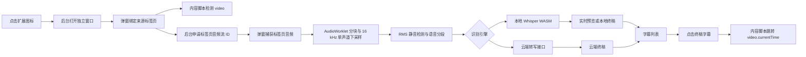

# video-subtitle-enhanced

一个基于 Chrome Manifest V3 的网页视频实时字幕扩展。它捕获当前标签页的音频，在独立的扩展窗口中实时展示带时间戳的字幕，并支持点击字幕跳转到视频对应位置。

当前版本：`2.0.0`

## 产品定位

面向没有字幕、字幕不可用或需要跨语言辅助观看的网页视频场景。扩展不修改视频网站页面，也不依赖视频平台提供字幕接口，而是直接处理标签页音频：

- 识别网页视频中的人声，生成可滚动的字幕列表。
- 字幕显示在扩展独立窗口中，不覆盖网页视频。
- 每条终稿字幕带视频时间戳，点击后可跳转并继续播放。
- 支持本地 Whisper、纯云端以及“本地预览 + 云端校正”的混合识别。
- 设置会保存在浏览器本地，字幕内容仅在当前窗口中保留。

## 核心能力

| 能力 | 用户可见行为 | 实现方式 |
| --- | --- | --- |
| 视频检测 | 打开视频页后点击扩展图标，窗口自动绑定该标签页 | 内容脚本选择页面中面积和播放状态最合适的 `<video>` |
| 标签页音频捕获 | 启动后分析当前标签页的声音 | `tabCapture` 获取音频流，`AudioWorklet` 分块采集；不支持时回退到 `ScriptProcessor` |
| 语音活动分段 | 自动跳过静音并切分可识别的语音片段 | 以 RMS 能量检测语音，结合前后缓冲、静音等待和最大时长切段 |
| 字幕展示 | 显示时间范围、终稿和“实时”预览 | 独立弹窗维护字幕列表，终稿最多保留最近 180 条 |
| 字幕跳转 | 点击任意终稿字幕，视频跳到该时间点并播放 | 弹窗通过后台脚本代理消息给内容脚本，设置 `video.currentTime` |
| 时间轴同步 | 字幕时间尽量对应视频播放时间 | 定期读取视频当前时间和暂停状态，动态校准音频时间与视频时间的偏移 |
| 模型切换 | 在 `tiny` 和 `base` 本地模型间切换 | 检测 `wasm/` 下模型文件，切换后重启识别 |

## 快速开始

### 环境要求

- 使用支持 Manifest V3、`tabCapture` 和 `AudioWorklet` 的 Chromium 系浏览器。
- 本地识别使用仓库内附带的 Whisper WASM 模型，无需额外安装 Python、Node.js 或构建工具。

### 安装扩展

1. 打开 `chrome://extensions/`。
2. 开启右上角的“开发者模式”。
3. 点击“加载已解压的扩展程序”。
4. 选择本项目根目录 `video-subtitle-extension`。

项目没有构建步骤，修改文件后需在扩展管理页点击“重新加载”。

### 使用流程

1. 在普通浏览器标签页中打开包含视频的网页并开始播放。
2. 点击浏览器工具栏中的扩展图标，扩展会打开一个约 `430 × 720` 的独立窗口。
3. 选择识别引擎、本地模型、字幕模式和云端参数。
4. 点击“启动实时字幕”。
5. 等待字幕出现在列表中；点击终稿字幕可跳转视频时间。

> 默认引擎是“混合（准确率优先）”，需要先填写云端 API Key。完全离线使用请切换到“纯本地（离线）”。

## 识别策略

### 三种识别引擎

| 引擎 | 字幕预览 | 终稿来源 | 是否需要云端 Key | 适用场景 |
| --- | --- | --- | --- | --- |
| 纯本地 | 本地 Whisper 生成实时预览 | 本地 Whisper | 否 | 离线使用、隐私优先、无云端费用 |
| 纯云端 | 不生成本地预览 | OpenAI 兼容转录接口 | 是 | 追求云端准确率、可接受段落结束后出字幕 |
| 混合 | 本地 Whisper 生成实时预览 | 云端接口校正；云端失败时回退本地 | 是 | 希望兼顾实时反馈和终稿准确率 |

混合模式的处理顺序如下：

1. 音频片段先经过本地 `tiny` 或 `base` 模型，实时显示临时字幕。
2. 完整语音段结束后发送到云端 `/audio/transcriptions`。
3. 云端成功时写入终稿，并移除临时字幕。
4. 云端失败且本地 Worker 可用时，改用本地终稿。

### 两种字幕模式

| 模式 | 分段行为 | 实时预览 | 特点 |
| --- | --- | --- | --- |
| 实时（低延迟） | 约 0.7～2.6 秒切分，静音等待约 0.25 秒 | 有，本地引擎下约每 0.75 秒更新一次 | 字幕出现更快，片段更短 |
| 准确（高延迟） | 约 2～11 秒聚合，静音等待约 0.95 秒 | 无 | 上下文更长，终稿通常更稳定 |

### 本地模型

| 模型 | 文件 | 大小 | 定位 |
| --- | --- | ---: | --- |
| tiny | `wasm/ggml-tiny.bin` | 约 74.1 MB | 速度优先，默认模型 |
| base | `wasm/ggml-base.bin` | 约 141.1 MB | 准确率优先，加载和识别开销更高 |

模型文件随项目提供。首次启动本地识别需要加载模型，扩展为初始化设置了 90 秒超时；模型切换或字幕模式切换会在识别运行中自动重启音频管线。

## 云端接口

云端识别调用：

```text
POST {API Base}/audio/transcriptions
Authorization: Bearer {API Key}
Content-Type: multipart/form-data
```

请求发送单声道、16 kHz、16-bit WAV 片段，并包含以下表单字段：

| 字段 | 当前值或行为 |
| --- | --- |
| `file` | `chunk-{timestamp}.wav` |
| `model` | 默认 `whisper-1`，可在界面修改 |
| `task` | `transcribe` |
| `temperature` | `0` |
| `response_format` | `verbose_json` |
| `language` | 中文、英文、日文或 `auto`；`auto` 时不发送该字段 |

默认 API Base 为 `https://api.openai.com/v1`，超时时间为 45 秒。接口返回的 `segments` 首尾时间会用于校正字幕时间范围。

## 业务链路



### 主要运行阶段

| 阶段 | 关键动作 | 失败时的表现 |
| --- | --- | --- |
| 打开窗口 | 后台记录被点击标签页的 `sourceTabId`，复用或创建独立窗口 | 找不到标签页时提示从视频页打开 |
| 启动前检查 | 检查标签页、`<video>`、可用本地模型和云端凭据 | 在状态区显示启动失败原因 |
| 音频捕获 | 后台生成音频流 ID，弹窗通过 `getUserMedia` 建立 `MediaStream` | 中止启动并清理音频节点 |
| 音频处理 | 混合多声道为单声道，降采样至 16 kHz，按能量切分 | 静音块不会产生字幕 |
| 识别调度 | 本地 Worker 单任务处理，云端请求串行排队 | 混合模式可回退本地；纯云端显示错误 |
| 字幕呈现 | 临时字幕原位更新，终稿追加到列表 | 空结果和重复结果会被过滤 |
| 停止 | 强制处理尾段、停止音轨、关闭音频上下文、清除临时字幕 | 继续保留本次窗口内的终稿字幕 |

## 项目结构

| 路径 | 作用 |
| --- | --- |
| `manifest.json` | Manifest V3 清单、权限、内容脚本、CSP 和版本信息 |
| `background.js` | 打开扩展窗口、代理页面消息、申请标签页音频流 ID |
| `content.js` | 检测顶层页面视频、读取播放状态、执行时间跳转 |
| `utils.js` | 内容脚本加载的时间与 VTT 辅助函数 |
| `popup/popup.html` | 独立操作窗口结构 |
| `popup/popup.css` | 弹窗、状态和字幕列表样式 |
| `popup/app.js` | 主业务编排：设置、音频管线、识别调度、字幕与时间轴 |
| `popup/audio-capture-processor.js` | `AudioWorklet` 音频分块处理器 |
| `popup/modules/config.js` | 模型、字幕模式、采样率与分段参数 |
| `popup/modules/segmenter.js` | 基于语音能量的片段切分和临时字幕窗口 |
| `popup/modules/cloud-asr.js` | WAV 编码、云端请求、串行队列和响应解析 |
| `popup/modules/utils.js` | 降采样、文本清理、去重和时间轴校准工具 |
| `asr-worker.js` | 加载 Whisper WASM 与模型，执行本地转写 |
| `wasm/` | Whisper 运行时代码、WASM 和 `tiny`/`base` 模型 |
| `icons/` | 扩展图标 |

## 隐私、存储与权限

| 项目 | 当前行为 |
| --- | --- |
| 音频处理 | 纯本地模式下音频不离开浏览器；云端和混合模式会把语音片段发送到配置的转录接口 |
| API Key | 通过 `chrome.storage.local` 明文保存在扩展本地存储中，不使用系统密钥链 |
| 字幕数据 | 仅保存在弹窗内存中，关闭窗口后清空，不上传、不导出 |
| 用户设置 | 模型、字幕模式、识别引擎、API Base、API Key、云端模型和语言会持久化 |
| 网站访问 | 内容脚本匹配 `<all_urls>`，用于在通用网页中检测视频 |
| 浏览器权限 | 使用 `tabCapture`、`tabs`、`activeTab`、`scripting`、`storage` 完成捕获、窗口管理和设置保存 |

### 网络白名单限制

`manifest.json` 当前的扩展页面 CSP 只允许连接以下云端域：

```text
https://api.openai.com
https://*.openai.com
```

虽然界面提供自定义 API Base，但如果不修改 CSP 的 `connect-src`，其他 OpenAI 兼容服务会在浏览器层被拦截。若部署自定义服务，需要同步调整 Manifest 的网络白名单，并重新加载扩展。

## 开发与验证

项目使用原生 HTML、CSS 和 JavaScript ES Modules，没有包管理依赖。常用检查命令：

```powershell
node --check background.js
node --check content.js
node --check asr-worker.js
node --check popup/app.js
```

本地调试建议：

1. 在 `chrome://extensions/` 打开扩展的 Service Worker 开发者工具。
2. 右键扩展窗口选择“检查”，查看弹窗与 Worker 日志。
3. 修改代码后在扩展管理页重新加载，再刷新视频页面。
4. 测试本地、云端和混合三种引擎，以及实时、准确两种字幕模式。
5. 验证字幕跳转、暂停与拖动进度后的时间轴同步、停止时尾段字幕和窗口关闭清理。

## 当前边界

| 边界 | 说明 |
| --- | --- |
| 显示形式 | 字幕只在扩展独立窗口显示，不会覆盖在视频画面上 |
| 页面范围 | 只检测内容脚本所在顶层页面中的 `<video>`；iframe 内视频、画布视频或复杂播放器可能无法识别或跳转 |
| 音频范围 | 捕获的是整个标签页音频，广告、提示音或同页其他媒体也可能进入识别 |
| 字幕留存 | 没有字幕导出、历史记录或跨窗口恢复功能 |
| 云端兼容性 | 客户端按 OpenAI 音频转录协议实现，且当前 CSP 仅放行 OpenAI 域名 |
| 浏览器范围 | 未做 Firefox 等非 Chromium 浏览器适配 |
| 自动化测试 | 仓库当前没有测试套件，需通过浏览器进行端到端验证 |

## 常见问题

| 问题 | 排查方向 |
| --- | --- |
| 提示“当前标签页未检测到视频” | 确认视频位于顶层页面且使用标准 `<video>`；尝试刷新页面后重新打开扩展 |
| 混合或云端模式无法启动 | 填写 API Key；不使用云端时切换到“纯本地（离线）” |
| 找不到本地模型 | 确认 `wasm/ggml-tiny.bin` 或 `wasm/ggml-base.bin` 存在，并在扩展页重新加载 |
| 首次启动等待较久 | `base` 模型和 WASM 初始化开销较大；可先使用 `tiny` |
| 自定义 API Base 请求失败 | 检查 Manifest CSP 是否允许该域名，以及接口是否兼容 `/audio/transcriptions` |
| 字幕时间偏移 | 等待自动校准；暂停、跳转或大幅拖进度会触发时间轴重新锚定 |
| 点击字幕没有反应 | 确认来源标签页仍存在，且页面包含可控制的视频元素 |
