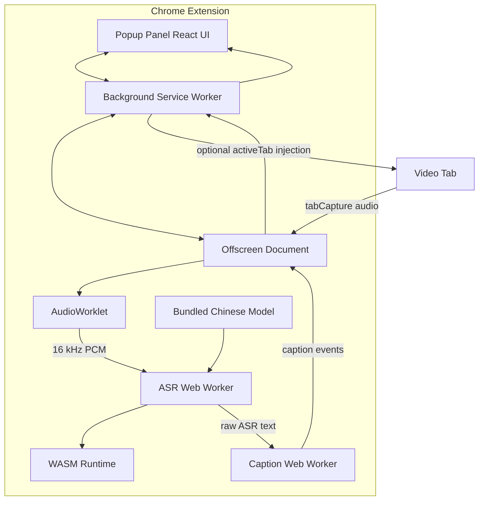

# 纯浏览器扩展中文字幕技术方案

| 项目 | 内容 |
| --- | --- |
| 文档状态 | 全新目标架构，替代此前的本地服务方案 |
| 产品形态 | 单个 Chrome Manifest V3 扩展 |
| 核心技术路线 | Offscreen 采音 + AudioWorklet + Web Worker + WebAssembly |
| 第一阶段输出 | 简体中文实时字幕 |
| 后续扩展 | 非中文翻译为中文、多目标语言、字幕导出 |
| 远程服务器 | 不需要 |
| 本地辅助服务 | 不需要 |
| 运行时网络依赖 | 无 |
| 文档日期 | 2026-11-06 |

## 1. 设计结论

最终产品必须做到：

```text
从 Chrome 插件市场安装扩展
→ 打开网页视频
→ 点击启动
→ 浏览器本地生成字幕
```

用户不需要：

- 安装 Python。
- 安装 Node.js。
- 手动启动本地服务。
- 购买或配置远程服务器。
- 注册账号。
- 上传音频。

因此目标架构确定为：

```text
纯 Chrome Extension
├── Popup Panel：独立窗口中的字幕界面和用户操作
├── Background Service Worker：标签页和会话协调
├── Offscreen Document：标签页音频捕获
├── AudioWorklet：16 kHz PCM 转换
├── ASR Web Worker：只输出原始语音识别文本
├── Caption Web Worker：独立执行分句和 CT-Punc
├── WebAssembly Runtime：ASR 与标点模型推理
└── Bundled Models：随扩展分发的量化模型
```

本文档是新的唯一目标架构。现有代码中的 Python、WebSocket 和本地推理服务不属于最终产品，将在重写过程中删除。

## 2. 产品目标

### 2.1 核心业务

系统只以网页视频的标签页音频作为输入，不读取视频网站自带字幕：

```text
网页视频音频
→ 标签页音频捕获
→ 人声检测和断句
→ 浏览器内中文语音识别
→ 临时字幕
→ 终稿字幕
→ 字幕展示和视频跳转
```

第一阶段固定输出简体中文。后续增加其他语言时，输入仍只来自音频，不使用平台字幕。

### 2.2 第一阶段范围

| 功能 | 第一阶段 |
| --- | --- |
| 捕获当前标签页音频 | 必须 |
| 自动检测人声 | 必须 |
| 中文流式识别 | 必须 |
| 临时中文字幕 | 必须 |
| 中文字幕终稿 | 必须 |
| 字幕时间轴 | 必须 |
| 点击字幕跳转视频 | 必须 |
| 完全浏览器内运行 | 必须 |
| Chrome 插件市场单包安装 | 必须 |
| 非中文翻译为中文 | 后续 |
| 多目标语言 | 后续 |
| SRT/VTT 导出 | 后续 |
| 语言自动检测 | 后续 |

### 2.3 非目标

- 不生成配音。
- 不进行声音克隆。
- 不抓取视频平台字幕。
- 不绕过 DRM。
- 不依赖远程 API。
- 不要求用户安装本地程序。
- 不在首版处理多人说话人分离。
- 不承诺低端设备上的高端模型性能。

## 3. 产品约束

### 3.1 Chrome 插件市场约束

Chrome Web Store 对 Manifest V3 扩展有明确限制：

| 约束 | 设计要求 |
| --- | --- |
| 禁止远程执行代码 | 所有 JS、WASM 和推理运行时必须随扩展打包 |
| 不允许 CDN 加载可执行代码 | 禁止运行时从 CDN 下载 JS/WASM |
| 权限需要最小化 | 优先使用 `activeTab` 和按需注入 |
| 单用途政策 | 扩展用途聚焦为网页视频音频字幕 |
| 隐私政策 | 明确音频不离开设备、不收集个人数据 |
| 审核可解释性 | 权限、数据流和模型来源必须可说明 |

模型权重必须在发布前决定：

1. 随扩展一起打包；或
2. 作为明确声明的数据资源下载。

第一阶段采用**随扩展打包**，避免远程代码和审核歧义。

### 3.2 浏览器能力约束

| 能力 | 用途 | 约束 |
| --- | --- | --- |
| `tabCapture` | 获取标签页音频 | 必须由用户操作触发 |
| Offscreen Document | 长期持有音频流 | 需要 `offscreen` 权限 |
| AudioWorklet | 音频重采样和分帧 | 不适合做重计算 |
| Web Worker | 模型推理 | 不阻塞 UI |
| WebAssembly | ONNX 推理 | 需要 `wasm-unsafe-eval` CSP |
| WebAssembly SIMD | 加速矩阵计算 | 目标设备需支持 |
| SharedArrayBuffer | 多线程 WASM | 需要跨源隔离，作为增强项 |
| WebGPU | 后续翻译或更大模型 | 不假设所有设备可用 |

### 3.3 模型体积约束

第一阶段使用中文流式 ASR 模型和 CT-Punc 中文标点恢复模型。

| 资源 | 策略 |
| --- | --- |
| 模型目录 | 随构建产物复制到 `dist/runtime` |
| 模型格式 | 只包含 tokens 和 int8 ONNX 文件 |
| 浮点模型 | 不随扩展发布 |
| 模型缓存 | 运行时从扩展资源加载到内存 |
| 模型更新 | 随扩展版本发布 |

建议首版扩展包预算：

```text
扩展代码 + UI + 两个 WASM 运行时 + ASR/标点 int8 模型 ≤ 350 MB
```

最终以压缩包体积实测为准。

## 4. 总体架构



### 4.1 线程和进程边界

| 执行上下文 | 生命周期 | 主要职责 |
| --- | --- | --- |
| Popup Panel | 用户关闭前 | UI、字幕渲染和设置 |
| Service Worker | 可随时休眠 | 标签页、权限和消息协调 |
| Offscreen Document | 音频会话期间 | 持有 MediaStream、音频管线、会话状态 |
| AudioWorklet | 音频上下文期间 | 低延迟 PCM 转换 |
| ASR Worker | 识别会话期间 | 模型加载、VAD 和原始识别 |
| Caption Worker | 识别会话期间 | 分句、标点恢复和 UI 字幕事件，不参与音频识别 |

推理不能放在 Service Worker 中，因为 MV3 Service Worker 会休眠，且不适合长时间 CPU 计算。

推理不能放在 AudioWorklet 中，因为 AudioWorklet 需要满足实时音频截止时间，不能在回调中执行模型推理。

ASR 与字幕后处理分别运行在 Offscreen 创建的两个独立 Web Worker 中。

两者只通过 `RawAsrCaptionEvent` 单向通信。ASR Worker 不导入分句器、不加载标点模型，
也不依赖 Caption Worker 就绪；Caption Worker 的加载、排队或异常不会停止音频捕获与语音识别。

## 5. 组件设计

### 5.1 Popup Panel

Popup Panel 是独立于网页的扩展弹窗，是字幕产品的主界面。

| 模块 | 职责 |
| --- | --- |
| 会话控制 | 启动、停止、重新开始 |
| 状态展示 | 模型加载、识别中、错误、性能 |
| 字幕列表 | 临时字幕、终稿字幕、点击跳转 |
| 设置 | 模型档位、低延迟/准确偏好、字幕字号 |
| 隐私说明 | 音频仅在本机浏览器中处理 |
| 窗口操作 | 使用 Chrome 原生标题栏关闭窗口 |

使用 `chrome.windows.create({ type: "popup" })` 创建独立窗口，不提供置顶模式。

第一阶段不显示目标语言选择，固定标记为“输出：简体中文”。

### 5.2 Background Service Worker

| 职责 | 说明 |
| --- | --- |
| 来源标签页 | 获取用户当前操作的标签页 |
| 音频授权 | 调用 `tabCapture.getMediaStreamId` |
| 页面能力 | 按需注入读取视频和跳转脚本 |
| Offscreen 生命周期 | 创建或复用 Offscreen Document |
| 消息路由 | 在 Popup Panel 和 Offscreen 之间转发 |

Service Worker 只保存轻量会话元数据，不保存完整音频或大量字幕。

### 5.3 Offscreen Document

| 职责 | 说明 |
| --- | --- |
| 建立音频流 | 使用 Stream ID 调用 `getUserMedia` |
| 保持视频声音 | 将捕获流重新连接到音频输出 |
| 建立 Worklet | 加载扩展内置 AudioWorklet |
| 创建 ASR Worker | 每个会话创建一个推理 Worker |
| 管理会话状态 | 分配 sessionId 和 segmentId |
| 收尾 | 停止轨道、关闭 AudioContext、终止 Worker |

Offscreen Document 必须同时声明：

```text
USER_MEDIA
AUDIO_PLAYBACK
```

前者用于音频捕获，后者用于保持原视频声音播放。

### 5.4 AudioWorklet

AudioWorklet 只处理音频格式，不进行语音识别。

| 项目 | 设计 |
| --- | --- |
| 输入 | 标签页音频，常见为 44.1 或 48 kHz |
| 声道 | 混合为单声道 |
| 输出采样率 | 16 kHz |
| 输出格式 | PCM signed 16-bit little-endian |
| 帧长 | 20 ms，即 320 samples |
| 传输 | `postMessage` + Transferable ArrayBuffer |

音频帧不得序列化为 JSON。

### 5.5 ASR Web Worker

| 职责 | 说明 |
| --- | --- |
| WASM 初始化 | 从扩展资源加载本地 WASM 运行时 |
| 模型加载 | 读取 tokens 和 int8 ONNX 文件 |
| VAD | 根据音频能量和状态切分语音段 |
| 流式识别 | 对当前语音段持续解码 |
| 原始临时结果 | 按节流间隔输出未分句文本 |
| 原始终稿 | 在语音结束时输出未分句文本 |
| 资源释放 | 会话停止后释放模型和会话内存 |

### 5.6 Caption Web Worker

| 职责 | 说明 |
| --- | --- |
| 输入 | ASR Worker 输出的原始临时和终稿文本 |
| 独立启动 | 与采音建立并行初始化，不阻塞 ASR 就绪后的音频采集 |
| 流式分句 | 对临时文本生成稳定前缀和可变尾句 |
| CT-Punc | 使用 ONNX Runtime Web 为实时预览和终稿恢复标点 |
| 模型边界 | 根据 CT-Punc 输出的句末和句中标点决定字幕切分位置 |
| 宽度兜底 | 模型没有给出可用边界时，才按目标长度和最大长度切分 |
| 实时合并 | 模型推理期间只保留最新待处理预览，避免旧预览排队造成延迟 |
| 原始透传 | 后处理未就绪或不可用时，Offscreen 直接把原始 ASR 结果转换为 UI 字幕 |
| 故障隔离 | 后处理异常不会停止、回滚或重复调用 ASR Worker |

模型和 WASM 只从 `chrome-extension://` 自身资源加载。

## 6. 权限设计

### 6.1 推荐权限

```json
[
  "activeTab",
  "offscreen",
  "scripting",
  "storage",
  "tabCapture",
  "tabs"
]
```

| 权限 | 必要性 |
| --- | --- |
| `activeTab` | 用户点击扩展后访问当前视频页 |
| `offscreen` | 在后台持有音频流 |
| `scripting` | 按需注入视频状态和跳转脚本 |
| `storage` | 在浏览器会话内保存弹窗窗口 ID 和会话状态 |
| `tabCapture` | 捕获标签页音频 |
| `tabs` | 获取当前标签页 ID |

### 6.2 不推荐 `<all_urls>` 常驻内容脚本

为降低插件市场审核风险和页面侵入，首版采用：

```text
用户点击扩展
→ 获得 activeTab 临时权限
→ 按需注入视频适配脚本
```

只在当前标签页生命周期内保留注入脚本，不申请永久全站内容脚本权限。

如果后续必须适配 iframe 或复杂页面，再评估增加特定站点权限。

### 6.3 CSP

推荐内容安全策略：

```text
script-src 'self' 'wasm-unsafe-eval';
object-src 'self';
connect-src 'self';
media-src 'self' blob:;
worker-src 'self';
```

要求：

- 不加载远程 JS。
- 不从 CDN 加载 WASM。
- 不从外部网络加载模型。
- `connect-src` 只允许扩展自身。
- `worker-src` 只允许扩展自身脚本；Chrome 扩展页面禁止使用 `blob:` Worker。

## 7. 模型与运行时

### 7.1 第一阶段模型

| 项目 | 内容 |
| --- | --- |
| ASR 模型 | `sherpa-onnx-streaming-zipformer-bilingual-zh-en-2023-02-20` |
| 标点模型 | `sherpa-onnx-punct-ct-transformer-zh-en-vocab272727-2024-04-12-int8` |
| ASR 推理 | Sherpa-ONNX WebAssembly SIMD |
| 标点推理 | ONNX Runtime Web，CPU WASM |
| 标点类别 | 无标点、逗号、句号、问号、顿号 |
| 许可 | ASR/CT-Punc Apache-2.0，ONNX Runtime MIT |

ASR 使用 Sherpa-ONNX 官方预编译包，包含：

```text
sherpa-onnx-asr.js
sherpa-onnx-wasm-main-asr.js
sherpa-onnx-wasm-main-asr.data
sherpa-onnx-wasm-main-asr.wasm
```

ASR 配置、词表和 int8 模型位于 `.data` 虚拟文件系统中。

标点模型只打包：

```text
model.int8.onnx
tokens.json
```

### 7.2 WASM 运行时

运行时必须在构建阶段固定版本并放入扩展包：

```text
dist/runtime/sherpa-onnx/
├── sherpa-onnx-asr.js
├── sherpa-onnx-wasm-main-asr.js
├── sherpa-onnx-wasm-main-asr.data
└── sherpa-onnx-wasm-main-asr.wasm

dist/runtime/onnxruntime-web/
├── ort.wasm.min.js
├── ort-wasm-simd-threaded.mjs
└── ort-wasm-simd-threaded.wasm

dist/runtime/ct-punc/
├── model.int8.onnx
└── tokens.json
```

要求：

1. 固定官方版本或固定 Git commit。
2. 在构建脚本中校验文件哈希。
3. 不允许运行时从 CDN 获取。
4. 保留第三方许可证。
5. 升级运行时必须通过模型兼容性和回归测试。

### 7.3 单线程和多线程

| 模式 | 优点 | 缺点 | 首版 |
| --- | --- | --- | --- |
| 单线程 WASM | 兼容性高 | 大模型推理较慢 | 默认 |
| SIMD 单线程 | 明显加速矩阵计算 | 仍需设备支持 SIMD | 优先 |
| 多线程 WASM | 可使用多核 | 需要 SharedArrayBuffer 和跨源隔离 | 实验增强 |
| WebGPU | 理论上更高吞吐 | 模型支持、显存和兼容性不确定 | 后续评估 |

首版应优先使用单线程 SIMD，避免因跨源隔离失败导致扩展不可用。

### 7.4 模型加载步骤

1. 用户点击“启动中文字幕”。
2. Popup Panel 先检查是否已经有活动会话。
3. Background 申请标签页音频流。
4. Offscreen Document 创建 ASR Worker。
5. ASR Worker 从扩展资源读取 runtime JS 并加载 WASM。
6. ASR Worker 读取 ASR tokens 和 int8 模型并创建 OnlineRecognizer。
7. ASR Worker 返回 `worker.ready`。
8. Offscreen 在后台启动 Caption Worker，同时继续建立 MediaStream 和音频管线。
9. Caption Worker 加载 ONNX Runtime Web、CT-Punc 模型和词表，并返回 `caption.ready`。
10. Caption Worker 就绪前，原始 ASR 字幕直接进入 UI；就绪后，原始字幕再送入 Caption Worker。

采音只等待 ASR Worker 就绪，不等待 Caption Worker。ASR 模型加载完成前不得开始消耗音频，
避免无意义缓冲；字幕后处理初始化不属于这个前置条件。

## 8. 音频捕获流程

### 8.1 启动

| 步骤 | 组件 | 操作 |
| --- | --- | --- |
| 1 | Popup Panel | 用户点击启动 |
| 2 | Background | 获取当前标签页 ID |
| 3 | Background | 注入视频检测脚本 |
| 4 | Background | 确认页面存在 `<video>` |
| 5 | Background | 申请 tabCapture Stream ID |
| 6 | Background | 创建 Offscreen Document |
| 7 | Offscreen | 创建 ASR Worker |
| 8 | ASR Worker | 初始化 runtime 和模型 |
| 9 | ASR Worker | 返回 `worker.ready` |
| 10 | Offscreen | 后台启动 Caption Worker，并并行建立 MediaStream |
| 11 | Offscreen | 建立 AudioContext 和 AudioWorklet |
| 12 | Offscreen | 连接播放监听和 ASR 采集分支 |
| 13 | Popup Panel | 收到 `session.started` |

Caption Worker 的 `caption.ready` 不是采音前置条件。其初始化期间产生的原始字幕由
Offscreen 直接转换为 `caption.preview` 或 `caption.final`，不会暂停或阻塞识别。

### 8.2 播放监听

捕获标签页后必须保留视频原声：

```text
MediaStreamSource
├── monitorGain(1.0) -> AudioContext.destination
└── AudioWorklet -> PCM -> ASR Worker
```

不得把麦克风采集当作输入，也不得把识别音频再次扬声器播放。

### 8.3 音频转换

| 环节 | 输出 |
| --- | --- |
| 多声道混合 | 单声道 Float32 |
| 重采样 | 16 kHz Float32 |
| 量化 | Int16 PCM |
| 分帧 | 每帧 320 samples |
| 时间戳 | 以会话开始为 0 的单调时间 |

## 9. 内部消息协议

由于不再使用网络服务，扩展内部消息使用 `chrome.runtime`、`MessagePort` 和 Transferable。

### 9.1 控制消息

```typescript
type StartPanelSession = {
  type: 'panel.start';
  sourceTabId: number;
};

type CaptureStart = {
  type: 'capture.start';
  streamId: string;
};

type CaptureSeek = {
  type: 'capture.seek';
};

type AsrStart = {
  type: 'asr.start';
  sessionId: string;
};
```

### 9.2 音频消息

Worker 通过 `MessagePort` 接收：

```typescript
type AudioFrame = {
  type: 'audio.frame';
  timestampUs: number;
  samples: ArrayBuffer;
};
```

发送时必须把 `samples.buffer` 放在 Transferable 列表中，避免复制。

### 9.3 字幕事件

```typescript
type CaptionPreviewEvent = {
  type: 'caption.preview';
  sessionId: string;
  parentSegmentId: string;
  parts: Array<{
    segmentId: string;
    text: string;
    audioStartUs: number;
    audioEndUs: number;
    stable: boolean;
  }>;
  processingMs: number;
};

type FinalCaptionEvent = {
  type: 'caption.final';
  sessionId: string;
  segmentId: string;
  parentSegmentId: string;
  audioStartUs: number;
  audioEndUs: number;
  text: string;
  processingMs: number;
};
```

要求：

1. 临时预览整体替换同一 `parentSegmentId` 的上一次预览。
2. 终稿写入后清除同一段的全部临时预览。
3. 不同会话的旧事件必须丢弃。
4. 文本为空时不发送字幕事件。
5. 字幕事件通过结构化克隆传递，不共享 DOM 引用。
6. ASR Worker 只能发送 `asr.caption`，不能直接发送 `caption.preview` 或 `caption.final`。
7. Caption Worker 只能消费 `asr.caption`，不能控制 ASR 开始、停止或重置。
8. Caption 事件在 Offscreen 分配单调递增的 `deliverySequence`。
9. Offscreen 到 Background、Background 到 Panel 的消息必须串行投递，Panel 丢弃旧序号。

## 10. 状态机

### 10.1 整体会话

```text
idle
  -> requesting-tab
  -> requesting-capture
  -> loading-model
  -> running
  -> draining
  -> idle
```

| 状态 | 用户操作 | 系统行为 |
| --- | --- | --- |
| `idle` | 启动 | 获取标签页 |
| `requesting-tab` | 取消 | 检查视频 |
| `requesting-capture` | 取消 | 申请音频 ID |
| `loading-model` | 停止 | 加载 ONNX |
| `running` | 停止 | 接收 PCM |
| `draining` | 等待 | 完成尾段 |
| `idle` | 启动或导出 | 释放资源 |

### 10.2 推理 Worker

```text
uninitialized
  -> loading
  -> ready
  -> decoding
  -> finalizing
  -> disposed
```

任何初始化失败都必须回到可清理状态，不保留半初始化 Worker。

## 11. VAD 与字幕分段

### 11.1 首版算法

首版采用轻量能量 VAD，作为可替换实现：

| 参数 | 默认值 |
| --- | ---: |
| 音频帧 | 20 ms |
| RMS 语音阈值 | 0.008 |
| 连续语音启动 | 3 帧 |
| 前置缓冲 | 300 ms |
| 结束静音 | 650 ms |
| 最短语音段 | 500 ms |
| 最长语音段 | 12 秒 |
| 临时结果间隔 | 250 ms |

所有参数必须集中在一个不可变配置对象中，不散落在业务代码里。

### 11.2 后续升级

第二阶段可替换为：

- Silero VAD WASM。
- FSMN-VAD 的浏览器兼容版本。
- 能量 VAD 与神经 VAD 双门限。

替换 VAD 时保持 `VAD` 接口和字幕协议不变。

### 11.3 分段流程

1. 累计最近 300 ms 音频作为前置缓冲。
2. 连续检测到语音后创建 `segmentId`。
3. 将前置缓冲和当前帧送入 OnlineRecognizer。
4. 每隔 250 ms 解码当前识别状态。
5. 若文本发生变化，ASR Worker 发送原始 `asr.caption` 预览事件。
6. Caption Worker 将原始预览转换为 `caption.preview` 分句批次；异常时 Offscreen 直接透传原始预览。
7. 静音达到阈值后停止当前段。
8. ASR Worker 发送该段的原始 `asr.caption` 终稿事件。
9. Caption Worker 优先按 CT-Punc 恢复的句末、句中标点切分终稿。
10. 模型没有给出可用边界时，才按目标字符数和最大字符数兜底切分。
11. 字幕文本不人工补标点，标点只来自 CT-Punc 或原始识别结果。
12. 每条字幕按字符权重分配原语音段的时间范围，并发送带 `parentSegmentId` 的 `caption.final`。
13. 创建新的识别流处理下一段。

## 12. 临时字幕与终稿

### 12.1 临时字幕

临时字幕允许不断修订：

```text
对
对我
对我做了
对我做了介绍
```

每次临时识别结果更新时，Caption Worker 先调用 CT-Punc 恢复当前文本的标点，
再根据模型标点把文本切分为一组临时字幕，
通过 `caption.preview` 一次性替换上一组预览。UI 使用黄色虚线样式显示，
并明确标记“实时”。

为了减少视觉跳动，预览采用“稳定前缀 + 可变尾句”：

1. 除最后一个分句外，已显示前缀在后续修订中保持文本不变。
2. 最后一条临时字幕随 ASR 结果增长或修订。
3. 出现新的稳定边界时，只追加新的尾句。
4. 终稿到达后统一清除临时前缀和尾句，再写入最终分句。

### 12.2 终稿字幕

语音段结束后输出稳定文本：

```text
对我做了介绍，那么我想说的是，大家如果对我的研究感兴趣……
```

终稿必须：

- 替换同段临时字幕。
- 不允许被迟到临时结果覆盖。
- 可以作为点击跳转目标。
- 可被后续导出逻辑使用。

### 12.3 去重

必须过滤：

- 完全相同的重复终稿。
- 同一段前后高度重叠的文本。
- 纯空白。
- 只有标点。
- 已知的噪声触发文本。

## 13. 时间轴

### 13.1 音频时间

音频时间以会话接收的第一帧为起点：

```text
audioTimestampUs = 帧序号 × 20,000
```

### 13.2 视频时间

页面脚本每秒读取：

```json
{
  "currentTime": 127.42
}
```

字幕视频时间使用锚点计算：

```text
videoTimeMs = anchorVideoTimeMs
  + (audioTimeMs - anchorAudioTimeMs) × playbackRate
```

锚点在开始、暂停恢复、播放器缓冲、跳转和倍速变化时重新建立。正常播放期间
每秒查询视频状态只用于检测变化，不重新计算所有已显示字幕的时间。

### 13.3 暂停和拖动

| 事件 | 行为 |
| --- | --- |
| 视频暂停 | 音频继续为静音，校准 offset |
| 视频继续 | 重新使用当前视频时间校准 |
| 用户拖动 | 立即重算 offset |
| 切换标签页 | 没有 activeTab 权限时提示重新点击扩展 |
| 视频元素替换 | 重新注入检测脚本并恢复适配 |

## 14. 字幕 UI

### 14.1 页面结构

```text
标题：实时中文字幕
副标题：浏览器本地识别，不上传音频

[启动中文字幕] [停止]

状态：
[已检测到视频] [已加载模型] [字幕: 12] [处理: 180ms]

字幕列表：
[00:00:11.073 → 00:00:11.840] [实时]
不少新面孔

[00:00:12.500 → 00:00:15.120]
德州州长也换成了民主党
```

### 14.2 状态类型

| 状态 | 文案 |
| --- | --- |
| 无视频 | 当前标签页未检测到视频 |
| 加载运行时 | 正在加载本地识别引擎 |
| 加载模型 | 正在加载中文模型 |
| 运行中 | 实时字幕识别中 |
| 收尾 | 正在生成最后一段字幕 |
| 模型错误 | 中文模型损坏或加载失败 |
| 内存不足 | 当前设备内存不足 |
| 不支持 | 浏览器不支持所需 WASM 能力 |

### 14.3 交互

- 终稿字幕可点击。
- 跳转后重置 ASR 当前分段，并过滤已覆盖时间段中的重复终稿。
- 临时字幕不可跳转。
- 字幕列表在用户位于底部时自动滚动到最新字幕。
- 用户手动向上滚动后暂停自动滚动，并显示“回到最新”按钮。
- 点击“回到最新”恢复自动跟随。
- 停止后保留本次会话终稿直到用户清除。
- 后续可增加“复制全部”和“导出 SRT/VTT”。

## 15. 数据存储

| 数据 | 存储 | 生命周期 |
| --- | --- | --- |
| 模型和 WASM | 扩展包 | 随版本更新 |
| 用户设置 | `chrome.storage.local` | 持久 |
| 当前字幕 | Offscreen 内存 | 会话期间 |
| 字幕历史 | 默认不保存 | 关闭后清空 |
| 音频 | 内存环形缓冲 | 最长数秒 |
| 模型缓存 | 浏览器进程内存 | Worker 生命周期 |

不得使用 IndexedDB 存储原始音频。

如果后续增加历史记录，应：

1. 默认关闭。
2. 只保存文本和时间轴。
3. 提供一键清除。
4. 不保存音频。

## 16. 性能预算

### 16.1 基准设备

首版验收设备：

```text
4 核 x86_64 桌面 CPU
8 GB RAM
Chrome 或 Edge 最新稳定版
支持 WebAssembly SIMD
```

低配设备可以运行，但不承诺相同性能。

### 16.2 性能目标

| 指标 | 目标 |
| --- | --- |
| 扩展启动 | < 300 ms |
| WASM 加载 | < 1.5 s |
| ASR 模型加载 | < 3 s |
| CT-Punc 模型加载 | < 5 s |
| 首条临时字幕 P95 | < 1.5 s |
| 临时字幕更新 | 250～600 ms |
| 终稿生成 | 语音结束后 < 1.5 s |
| 实时率 RTF P95 | < 0.8 |
| 会话内存峰值 | < 800 MB |
| 连续运行 | 2 小时无持续内存增长 |

### 16.3 降级策略

当实时率持续超过 1：

1. 增加临时结果间隔。
2. 降低解码更新频率。
3. 关闭非必要 UI 动画和调试日志。
4. 提示用户关闭其他高 CPU 页面。
5. 如果仍无法恢复，建议改用更小模型。

首版不得为了追求实时性丢弃终稿任务。

## 17. 内存与资源管理

| 资源 | 生命周期 |
| --- | --- |
| MediaStream | 会话开始到停止 |
| AudioContext | 会话开始到停止 |
| AudioWorklet | AudioContext 生命周期 |
| ASR Worker | 模型加载到会话停止 |
| WASM 实例 | Worker 生命周期 |
| 模型数据 | Worker 生命周期 |
| 音频块 | 发送后立即释放 |

停止会话必须按顺序执行：

1. 停止接收新音频。
2. 刷新最后一帧和尾段。
3. 发送最后一条终稿。
4. 通知 Worker 释放流。
5. 终止 Worker。
6. 断开音频节点。
7. 停止 MediaStream 轨道。
8. 关闭 AudioContext。
9. 清理 Offscreen 会话状态。

## 18. 错误处理

| 错误 | 原因 | 处理 |
| --- | --- | --- |
| `NO_ACTIVE_TAB` | 没有活动标签页 | 提示点击扩展后重试 |
| `NO_VIDEO` | 页面没有 `<video>` | 提示打开视频 |
| `CAPTURE_DENIED` | 用户或浏览器拒绝捕获 | 显示权限提示 |
| `WASM_UNSUPPORTED` | 浏览器不支持 | 说明浏览器要求 |
| `SIMD_UNSUPPORTED` | SIMD 不可用 | 尝试兼容构建 |
| `RUNTIME_LOAD_FAILED` | 运行时损坏 | 提示重新安装扩展 |
| `MODEL_LOAD_FAILED` | 模型缺失或损坏 | 显示模型错误 |
| `MODEL_HASH_MISMATCH` | 打包文件被篡改 | 终止会话 |
| `OUT_OF_MEMORY` | 模型或音频缓冲过大 | 清理会话并提示 |
| `WORKER_CRASHED` | 推理进程异常 | 停止会话，允许重试 |
| `AUDIO_TRACK_ENDED` | 标签页音频结束 | 自动收尾 |
| `VIDEO_NAVIGATED` | 页面跳转 | 停止会话并重新检测 |

错误必须包含稳定错误码，UI 文案与错误码分离。

## 19. 隐私

- 音频只在扩展运行内存中处理。
- 不发送外部网络请求。
- 不保存原始音频。
- 不上传字幕文本。
- 不包含统计埋点。
- 不包含用户账号。
- 默认不保存历史。
- 隐私政策明确说明不收集可识别个人身份的数据。

由于扩展需要捕获标签页音频，商店页面和隐私政策必须单独说明：

1. 只处理用户主动启动的标签页。
2. 捕获内容用于本地字幕生成。
3. 数据不离开设备。
4. 停止后释放音频流。

## 20. 插件市场发布

### 20.1 发布包

```text
release/
└── video-subtitle-extension.zip
```

解压内容必须包含：

```text
manifest.json
background.js
offscreen.html
offscreen.js
panel.html
panel.js
panel.css
audio-capture-processor.js
asr-worker.js
caption-worker.js
runtime/sherpa-onnx/*
runtime/ct-punc/*
runtime/onnxruntime-web/*
models/zh/*
icons/*
LICENSES/*
```

### 20.2 商店资料

| 项目 | 内容 |
| --- | --- |
| 单一用途 | 网页视频音频识别和中文字幕 |
| 权限说明 | 解释 `tabCapture`、`offscreen`、`activeTab` |
| 隐私政策 | 本地处理、无数据收集 |
| 数据使用声明 | 不收集、不出售、不共享 |
| 模型来源 | 开源模型与许可证 |
| 最低浏览器 | 支持 WASM SIMD 的 Chromium 版本 |

### 20.3 审核风险

| 风险 | 控制 |
| --- | --- |
| 远程代码 | 所有运行时和模型打包 |
| 过宽权限 | 使用 activeTab 按需注入 |
| 音频权限敏感 | 明确用户主动触发和本地处理 |
| 包体过大 | 只打包 int8 模型 |
| 模型许可证 | 保留模型和运行时许可证 |
| 第三方库漏洞 | 锁定版本并执行依赖审计 |

## 21. 测试方案

### 21.1 单元测试

- PCM 重采样。
- 20 ms 分帧。
- RMS 计算。
- 语音段开始和结束。
- 临时预览批次替换规则。
- 时间轴计算。
- 字幕去重。
- 错误码映射。

### 21.2 Worker 测试

- WASM 加载。
- int8 模型加载。
- 增量识别。
- 尾段刷新。
- 资源释放。
- 模型缺失和损坏。

### 21.3 扩展集成测试

- 点击扩展打开独立 Popup Panel。
- 获取当前标签页。
- 申请 tabCapture。
- Offscreen 创建音频流。
- 原视频声音保持可听。
- 字幕事件到达 UI。
- 停止后释放全部资源。

### 21.4 Chrome Web Store 验收

- 无外部网络请求。
- 无远程脚本。
- 无未声明权限。
- 隐私政策可访问。
- 包体和许可证完整。

## 22. 验收标准

第一阶段必须满足：

1. 只安装一个扩展就能使用。
2. 不需要 Python、Node.js 或本地服务。
3. 不需要远程服务器。
4. 不读取网页平台字幕。
5. 能捕获标签页音频。
6. 音频保持正常播放。
7. 中文语音产生临时字幕。
8. 语音段结束后产生终稿。
9. 终稿替换临时字幕且无重复。
10. 点击终稿可以跳转视频。
11. 关闭或停止后音频资源释放。
12. 默认不向外部网络发送任何数据。
13. 扩展包内包含 WASM、模型和许可证。
14. 扩展可以加载到 Chrome 和 Edge。
15. 首条临时字幕满足目标硬件性能线。

## 23. 实施阶段

### 阶段 1：纯扩展骨架

| 项目 | 交付 |
| --- | --- |
| 目标 | 无服务化 |
| 内容 | 删除 Python、WebSocket 和本地服务依赖 |
| 交付 | Background、Offscreen、Popup Panel、权限 |
| 完成标准 | 能从扩展打开独立弹窗并检测视频 |

### 阶段 2：音频捕获

| 项目 | 交付 |
| --- | --- |
| 目标 | 获得稳定 PCM |
| 内容 | tabCapture、播放监听、AudioWorklet、Transferable |
| 完成标准 | 16 kHz PCM 连续输出，视频原声可听 |

### 阶段 3：浏览器内中文 ASR

| 项目 | 交付 |
| --- | --- |
| 目标 | 不依赖服务器 |
| 内容 | ASR Worker、WASM、int8 中文模型 |
| 完成标准 | 真实音频产生中文临时字幕 |

### 阶段 4：VAD 和字幕终稿

| 项目 | 交付 |
| --- | --- |
| 目标 | 正确切分和稳定字幕 |
| 内容 | 能量 VAD、CT-Punc 实时与终稿标点、模型标点驱动分句 |
| 完成标准 | 静音不字幕，终稿具有模型恢复的中文标点 |

### 阶段 5：UI 和时间轴

| 项目 | 交付 |
| --- | --- |
| 目标 | 可交付使用 |
| 内容 | 字幕列表、状态、错误、视频跳转 |
| 完成标准 | 完整字幕观看链路可用 |

### 阶段 6：性能与稳定性

| 项目 | 交付 |
| --- | --- |
| 目标 | 达到上架标准 |
| 内容 | 资源释放、内存测试、RTF、SIMD 兼容 |
| 完成标准 | 2 小时稳定运行，不持续增长 |

### 阶段 7：Chrome Web Store 打包

| 项目 | 交付 |
| --- | --- |
| 目标 | 可提交审核 |
| 内容 | release ZIP、许可证、隐私说明、权限说明 |
| 完成标准 | 包内无远程代码，无未声明依赖 |

## 24. 后续多语言设计

多语言不能重新引入服务器依赖。

推荐扩展为：

```text
ASR Worker
  → 源语言识别
  → Translation Worker
  → 目标语言字幕
```

翻译 Worker 可使用：

- 浏览器内 ONNX 翻译模型。
- WebGPU 推理模型。
- 按目标语言分包的模型资源。

模型必须随扩展或作为经过商店政策审核的数据包提供，不能运行时下载任意可执行代码。

多语言阶段仍需保留：

- 本地优先。
- 无账号。
- 无远程音频上传。
- 单扩展安装。

## 25. 风险与决策

| 风险 | 决策 |
| --- | --- |
| 浏览器性能不足 | 使用 14M int8 流式模型，提供性能告警 |
| 模型体积大 | 只打包 int8 和必要 token |
| 多线程兼容性 | 首版使用 SIMD 单线程 |
| WebGPU 兼容性 | 不作为首版必需能力 |
| 权限审核 | 使用 activeTab 按需注入 |
| 远程代码审核 | 所有 JS/WASM 随扩展打包 |
| 模型许可证 | 随包提供 LICENSE |
| 大模型准确率 | 后续通过独立终稿模型解决 |
| iframe 视频 | 首版明确为不支持或后续按站点适配 |
| 跨平台差异 | 首版只承诺 Chrome/Edge 桌面版 |

## 26. 最终方案摘要

| 决策 | 结论 |
| --- | --- |
| 产品形态 | 单个 Chrome Extension |
| 服务器 | 不需要 |
| 本地服务 | 不需要 |
| 音频捕获 | tabCapture + Offscreen + AudioWorklet |
| 推理 | 扩展内 Web Worker + WebAssembly |
| 模型 | int8 Streaming Zipformer + CT-Punc |
| 首版语言 | 简体中文 |
| 字幕 | 临时结果 + 终稿替换 |
| 网络 | 默认完全关闭 |
| 发布 | Chrome Web Store 单包 |
| 后续翻译 | 浏览器内本地翻译 Worker |
