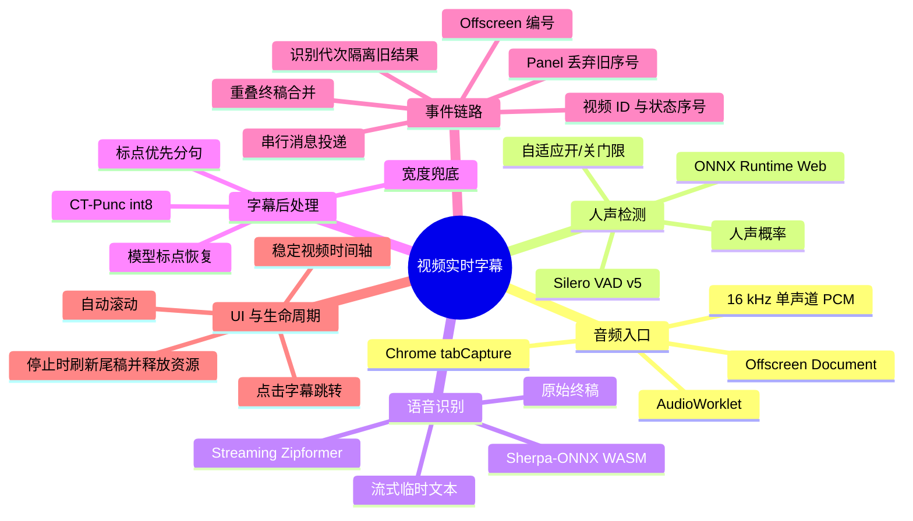

# 当前运行架构与执行流程

| 项目             | 当前状态                |
| ---------------- | ----------------------- |
| 产品版本         | `3.0.0`                 |
| 文档日期         | 2026-11-06              |
| 产品形态         | Chrome Manifest V3 扩展 |
| 当前输出         | 简体中文验证链路        |
| 运行位置         | 浏览器本地              |
| 远程服务器       | 无                      |
| 神经网络模型数量 | 3                       |

本文描述当前代码实际运行方式。多语言识别、目标语言选择和翻译不在当前实现范围内。

## 流程脑图



## 端到端执行顺序

| 顺序 | 阶段             | 执行位置                     | 核心技术                      | 输出                     |
| ---: | ---------------- | ---------------------------- | ----------------------------- | ------------------------ |
|    1 | 打开字幕窗口     | Background、Panel            | Chrome Windows API、React     | 字幕控制窗口             |
|    2 | 申请标签页音频   | Background                   | `chrome.tabCapture`           | MediaStream ID           |
|    3 | 建立本地音频环境 | Offscreen                    | Offscreen Document            | 音频会话                 |
|    4 | 加载模型         | VAD Worker、ASR Worker       | Sherpa-ONNX、ONNX Runtime Web | VAD + ASR 就绪           |
|    5 | 音频转换和分帧   | AudioWorklet                 | Web Audio API                 | 16 kHz PCM16，每帧 20 ms |
|    6 | 人声检测         | VAD Worker                   | Silero VAD v5                 | 人声概率和语音段         |
|    7 | 流式识别         | ASR Worker                   | Streaming Zipformer           | 原始预览和终稿           |
|    8 | 标点恢复         | Punctuation Worker           | CT-Punc int8                  | 带标点文本               |
|    9 | 字幕切分         | Segmentation Worker          | 模型标点优先规则              | 一条或多条字幕           |
|   10 | 有序投递         | Offscreen、Background、Panel | `deliverySequence`、串行消息  | 按产生顺序显示           |
|   11 | UI 展示          | Panel                        | React                         | 时间轴、自动滚动、跳转   |
|   12 | 停止和收尾       | 全链路                       | Flush 和资源释放              | 最后终稿、关闭会话       |

## 1. 模型清单与职责

当前使用三个相互独立的神经网络模型，依次负责“人声检测”“音频转文字”和“文字加标点”。

| 模型                    | 处理阶段 | 核心作用               | 执行位置           |
| ----------------------- | -------- | ---------------------- | ------------------ |
| Silero VAD v5           | ASR 之前 | 判断音频块是否包含人声 | VAD Worker         |
| Streaming Zipformer ASR | VAD 之后 | 把人声识别为原始文字   | ASR Worker         |
| CT-Punc                 | ASR 之后 | 为原始文字插入标点     | Punctuation Worker |

当前没有语言检测、翻译、说话人分离或目标语言模型。

### 1.1 Streaming Zipformer ASR

#### ASR 模型基本信息

| 项目       | 内容                                                        |
| ---------- | ----------------------------------------------------------- |
| 模型标识   | `streaming-zipformer-bilingual-zh-en-2023-02-20`            |
| 模型类型   | 流式 Zipformer 中英双语自动语音识别                         |
| 模型文件   | `encoder.onnx`、`decoder.onnx`、`joiner.onnx`、`tokens.txt` |
| 封装位置   | Sherpa-ONNX `.data` 虚拟文件系统                            |
| 推理运行时 | Sherpa-ONNX v1.13.7 WebAssembly SIMD                        |
| 执行位置   | `apps/extension/src/asr-worker.ts`                          |

编码器、解码器、联合网络和词表是一个 ASR 系统的组成部分，不是三个独立模型。

#### ASR 模型输入

```text
16 kHz
单声道
Float32 波形送入模型
VAD 只转发检测为人声的音频块
每块 512 samples，持续 32 ms
```

#### ASR 模型职责

1. 接收当前语音识别流中的音频。
2. 持续更新流式识别结果。
3. 把语音转换成中英文字符。
4. 在语音进行中输出临时预览文本。
5. 在语音段结束时输出最终原始文本。

示例：

```text
音频：“对我做了介绍那么我想说的是大家如果对我的研究感兴趣呢”
ASR 输出：对我做了介绍那么我想说的是大家如果对我的研究感兴趣呢
```

ASR 配置使用 `enableEndpoint = 0`，因此识别段起止由应用层 VAD 决定，不使用模型内置端点检测。

#### ASR 模型输出

```typescript
{
  kind: 'preview' | 'final',
  text: '原始识别文本',
  audioStartUs,
  audioEndUs,
  processingMs
}
```

### 1.2 Silero VAD v5

#### VAD 模型基本信息

| 项目       | 内容                                 |
| ---------- | ------------------------------------ |
| 模型       | `silero-vad-v5`                      |
| 类型       | 神经网络人声活动检测                 |
| 模型文件   | `silero_vad_v5.onnx`                 |
| 推理运行时 | ONNX Runtime Web 1.31.1，WASM 单线程 |
| 执行位置   | `apps/extension/src/vad-worker.ts`   |

#### VAD 模型输入

```text
AudioWorklet 输出的 16 kHz 单声道 PCM
→ 每 20 ms 一帧
→ VAD Worker 累积为 512 samples，即 32 ms VAD 块
→ 附加前一块末尾 64 samples 作为上下文
→ 输入 Silero VAD
```

#### VAD 模型职责

1. 输出每个音频块包含人声的概率。
2. 根据自适应正负概率阈值判断人声开始、持续和结束。
3. 在开始时提供最近 300 ms 前置音频。
4. 在人声结束后结束 ASR 识别段。

#### VAD 模型输出

```text
每个 32 ms 音频块的人声概率
→ 语音开始 / 语音继续 / 语音结束
```

VAD Worker 通过 Offscreen 将前置缓冲和语音音频块发送给 ASR Worker。

### 1.3 CT-Punc

#### 标点模型基本信息

| 项目         | 内容                                                                 |
| ------------ | -------------------------------------------------------------------- |
| 模型标识     | `sherpa-onnx-punct-ct-transformer-zh-en-vocab272727-2024-04-12-int8` |
| 模型类型     | CT-Transformer 标点恢复，int8 ONNX                                   |
| 模型文件     | `model.int8.onnx`、`tokens.json`                                     |
| 推理运行时   | ONNX Runtime Web 1.31.1，WASM 单线程                                 |
| 执行位置     | `apps/extension/src/punctuation-worker.ts`                           |
| 单次输入上限 | 200 个 token；超过时保持原始文本                                     |

#### 标点模型输入

```text
ASR 输出的无标点或弱标点文本
→ 清理原有标点
→ 中文按字符、英文按单词切分
→ 查询 tokens.json 得到 token ID
→ 输入 CT-Punc
```

#### 标点模型职责

1. 判断每个文本 token 后面应该使用什么标点。
2. 输出无标点、逗号、句号、问号或顿号。
3. 把选中的标点写回 ASR 文本。
4. 同时处理实时预览文本和最终文本。

示例：

```text
ASR：对我做了介绍那么我想说的是大家如果对我的研究感兴趣呢
CT-Punc：对我做了介绍，那么我想说的是，大家如果对我的研究感兴趣呢。
```

CT-Punc 为每个 token 输出标点类别，字幕切分器再消费这些标点。模型负责标点位置，切分器负责最终字幕排版和最大宽度。

#### 标点模型输出

```text
带标点文本
```

### 1.4 三个模型如何协作

```text
PCM 音频
→ Silero VAD：判断是否有人声并确定识别段
→ Streaming Zipformer ASR：音频转文字
→ 无标点原始文本
→ CT-Punc：插入标点
→ 带标点文本
→ 字幕切分器
→ 一条或多条 UI 字幕
```

完整示例：

```text
ASR 输出：
对我做了介绍那么我想说的是大家如果对我的研究感兴趣呢

CT-Punc 输出：
对我做了介绍，那么我想说的是，大家如果对我的研究感兴趣呢。

字幕切分器输出：
1. 对我做了介绍，
2. 那么我想说的是，大家如果对我的研究感兴趣呢。
```

### 1.5 非模型能力

| 能力     | 当前实现                               |
| -------- | -------------------------------------- |
| 字幕切分 | 模型标点优先、字幕宽度兜底的确定性算法 |
| 语言检测 | 未实现                                 |
| 翻译     | 未实现                                 |

当前有三个神经网络模型，不存在语言检测、翻译或目标语言模型。

## 2. 组件架构

```text
视频网页
  │ chrome.tabCapture
  ▼
Offscreen Document
  ├── AudioWorklet
  │     └── 混音、16 kHz 重采样、PCM16、20 ms 分帧
  ├── VAD Web Worker
  │     ├── ONNX Runtime Web
  │     └── Silero VAD v5
  ├── ASR Web Worker
  │     ├── Sherpa-ONNX WASM
  │     └── Streaming Zipformer
  ├── Punctuation Web Worker
  │     ├── ONNX Runtime Web
  │     └── CT-Punc
  └── Segmentation Web Worker
        └── 标点优先分句

Offscreen
  │ 串行 inference.event
  ▼
Background Service Worker
  │ 串行转发
  ▼
Popup Panel
  └── 字幕列表、时间轴、跳转、自动滚动
```

| 组件                         | 生命周期              | 主要职责                                     |
| ---------------------------- | --------------------- | -------------------------------------------- |
| `background.ts`              | MV3 Service Worker    | 窗口、标签页、音频权限、Offscreen 和事件路由 |
| `page-bridge.ts`             | 当前网页标签页        | 查询 `<video>`、执行跳转                     |
| `offscreen.ts`               | 音频会话期间          | 持有音频流、Worker 和串行事件队列            |
| `audio-capture-processor.ts` | AudioContext 生命周期 | 混音、重采样、PCM16 和分帧                   |
| `vad-worker.ts`              | 识别会话期间          | Silero VAD、人声分段和语音帧输出             |
| `asr-worker.ts`              | 识别会话期间          | Streaming ASR 和原始识别文本                 |
| `punctuation-worker.ts`      | 识别会话期间          | CT-Punc 标点恢复和预览合并                   |
| `segmentation-worker.ts`     | 识别会话期间          | 模型标点驱动分句和字幕事件                   |
| `panel.tsx`                  | 字幕窗口打开期间      | 启动停止、字幕展示、去重和时间轴             |
| `packages/protocol`          | 编译期类型            | 扩展内部消息协议                             |

## 3. 启动顺序

```text
用户点击扩展图标
→ Background 打开或复用字幕 Panel
→ Panel 请求当前视频状态
→ 用户点击启动
→ Background 注入 page-bridge 并确认存在 video
→ Background 申请 tabCapture Stream ID
→ Background 创建或复用 Offscreen
→ Offscreen 创建 VAD Worker 和 ASR Worker
→ VAD Worker 加载 Silero VAD 和 ONNX Runtime
→ ASR Worker 加载 Sherpa-ONNX 和 Streaming Zipformer
→ 两个 Worker 分别返回 ready
→ Offscreen 后台创建 Punctuation Worker 和 Segmentation Worker
→ Offscreen 建立 MediaStream
→ Offscreen 建立 AudioContext 和 AudioWorklet
→ 音频进入扬声器监听分支和 PCM 分析分支
→ Offscreen 返回 startedAtEpochMs
```

Offscreen 只有在 VAD Worker 和 ASR Worker 都就绪后才开始采音。标点和分句 Worker 不在采音前置条件中，继续在后台初始化。

## 4. 音频处理

```text
MediaStreamSource
├── monitorGain(1.0) → AudioContext.destination
└── AudioWorkletNode → analysisGain(0.0) → AudioContext.destination
```

| 属性   | 当前值                          |
| ------ | ------------------------------- |
| 采样率 | 16 kHz                          |
| 声道   | 单声道                          |
| 格式   | signed PCM16                    |
| 帧长   | 320 samples                     |
| 帧时长 | 20 ms                           |
| 时间戳 | VAD Worker 按累计 sample 数换算 |

PCM `ArrayBuffer` 使用 Transferable 发给 VAD Worker。VAD 命中的语音块再以 Float32 发给 ASR Worker。

## 5. VAD 与 ASR 执行顺序

| 参数             |             当前值 |
| ---------------- | -----------------: |
| VAD 音频块       | 512 samples，32 ms |
| 人声概率开始阈值 | 自适应；预热 `0.5` |
| 人声概率结束阈值 | 自适应；预热 `0.35` |
| 连续人声启动     | 2 个 VAD 块，64 ms |
| 前置缓冲         |             300 ms |
| 结束静音         |             650 ms |
| 最长语音段       |              12 秒 |
| 临时结果间隔     |             250 ms |

```text
20 ms PCM 音频帧
→ 累积为 32 ms VAD 块
→ Silero VAD 输出人声概率
→ 自适应门限判断人声开始
→ 连续 2 个 VAD 块有人声后创建语音段
→ 没有活动识别段时维护最多 300 ms 前置缓冲
→ 发送 vad.speech-start
→ 将前置缓冲和语音块以 vad.speech-frame 发给 ASR Worker
→ ASR Worker 创建 RecognizerStream
→ 每 250 ms 检查流式解码结果
→ 文本变化时发送 asr.caption preview
→ 低于自适应结束阈值的音频块累计达到 650 ms
→ 或段长达到 12 秒
→ VAD Worker 发送 vad.speech-end
→ ASR Worker 解码最终文本
→ 发送 asr.caption final
→ 释放 RecognizerStream
```

当前模型配置：

```text
enableEndpoint = 0
decodingMethod = greedy_search
maxActivePaths = 4
modelingUnit = cjkchar
```

分段结束由 Silero VAD 概率控制，没有使用 ASR 模型自带的 endpoint。

自适应门限由 `adaptive-vad.ts` 计算。Silero 仍负责输出概率，自适应门限负责把
概率转换成带滞回的人声状态：

1. 前 32 个非语音块使用 `0.5 / 0.35` 作为启动引导阈值。
2. 稳定运行后保留最近 160 个非语音概率样本。
3. 噪声底取第 20 百分位，信号峰值取第 90 百分位。
4. 开始阈值为 `noiseFloor + max(0.22, dynamicRange × 0.55)`，限制在 `0.3～0.85`。
5. 结束阈值为 `noiseFloor + dynamicRange × 0.25`，限制在 `0.12～开始阈值减 0.08`。
6. 人声活动期间冻结噪声学习，避免把持续讲话误判为背景噪声。

这些常量只用于把模型概率映射为业务状态，不是基于音量大小的固定 RMS 静音阈值。

## 6. 字幕后处理

ASR Worker 只发送：

```typescript
{
  type: 'asr.caption',
  kind: 'preview' | 'final',
  recognitionEpoch,
  sessionId,
  segmentId,
  audioStartUs,
  audioEndUs,
  text,
  processingMs
}
```

Offscreen 路由规则：

| 状态                       | 行为                           |
| -------------------------- | ------------------------------ |
| 标点和分句 Worker 都已就绪 | 原始文本进入标点 Worker        |
| 任一 Worker 尚未就绪       | 原始文本直接转换为 UI 字幕     |
| 标点或分句 Worker 异常退出 | 后续原始文本直接转换为 UI 字幕 |

Punctuation Worker 队列规则：

1. 终稿按到达顺序处理，不丢弃。
2. 尚未处理的旧预览会被最新预览替换。
3. 同段终稿到达时，删除该段仍在等待的预览。
4. `punctuation.flush` 等待已有任务完成后返回 `punctuation.drained`。

Segmentation Worker 只消费 `punctuation.result`，不接触音频和 ASR 状态。

CT-Punc 执行顺序：

```text
原始文本
→ 清理已有标点
→ 按中文字符和英文词切分
→ 查询 token ID
→ ONNX CT-Punc 推理
→ 每个 token 选择最高分标点类别
→ 将标点写回文本
```

字幕切分规则：

| 规则       | 当前实现                         |
| ---------- | -------------------------------- |
| 首选边界   | CT-Punc 输出的句号、问号、逗号等 |
| 目标长度   | 20 个字符                        |
| 最大长度   | 28 个字符                        |
| 无标点兜底 | 在最大宽度内按字符位置切分       |
| 人工补标点 | 不做                             |
| 连接词词典 | 不使用                           |
| 时间分配   | 按分句字符权重分配原识别段时长   |

一个 ASR 终稿可以产生多条 `caption.final`。

## 7. 从 Worker 到 UI

### 7.1 串行投递

```text
Offscreen 分配 deliverySequence
→ 等待 Background 确认
→ Background 串行转发 Panel
→ Panel 丢弃旧序号
```

Panel 行为：

1. `deliverySequence` 小于等于已处理序号的事件丢弃。
2. 字幕事件的 `recognitionEpoch` 必须等于 Panel 当前代次。
3. 暂停、恢复和跳转时 Offscreen 递增代次，旧 ASR、标点和分句结果全部丢弃。
4. 字幕显示使用事件处理顺序，不再按时间重新排序。
5. 同一 `parentSegmentId` 的新预览整体替换旧预览。
6. 同段终稿到达后删除该段全部临时字幕。

### 7.2 时间轴

```text
videoTimeMs = anchorVideoTimeMs
  + (audioTimeMs - anchorAudioTimeMs) × playbackRate
```

时间轴锚点在开始、暂停恢复、播放器缓冲、跳转和倍速变化时重建。页面脚本监听
`play`、`pause`、`seeking`、`seeked`、`ratechange`、`ended` 和 `loadedmetadata`
等事件并立即上报状态；正常播放时只在下一个字幕区间边界设置一次定时器，不进行固定间隔轮询。

页面边界定时器使用：

```text
等待时间 = (边界视频时间 - 当前视频时间) / playbackRate
```

播放、暂停、速度、跳转或视频元素状态改变后，旧定时器会取消并按新状态重新调度。
页面状态携带 `videoId` 和单调递增的 `sequence`；Panel 只接受当前视频且序号更新的
状态，旧视频的边界定时器也会因 `videoId` 不匹配而失效。

### 7.3 重复字幕合并

| 情况                            | 行为 |
| ------------------------------- | ---- |
| 时间重叠且一段文本包含另一段    | 合并 |
| 时间重叠且共享至少 6 个连续字符 | 合并 |
| 文本无关或时间不重叠            | 保留 |

合并后保留更完整文本，并使用两段最早开始时间和最晚结束时间。

## 8. UI 行为

| 功能     | 数据来源                           |
| -------- | ---------------------------------- |
| 临时字幕 | `caption.preview`                  |
| 终稿字幕 | `caption.final`                    |
| 处理耗时 | `processingMs`                     |
| 识别状态 | `session.status`                   |
| 错误状态 | `session.error` 或 `caption.error` |

- 点击任意终稿只调整视频时间，不直接决定是否识别。
- 当前视频时间落在任意已生成字幕区间内时，暂停识别。
- 当前视频时间离开所有已生成字幕区间后，自动恢复识别。
- 已经生成字幕的时间区间视为已识别区间，回放时跳过。
- 历史时间中存在未生成字幕的空档时，继续识别该空档。

例如已经生成 `5～8 秒` 字幕后回到 `1 秒`：

```text
1～5 秒：未识别区间，继续生成
5～8 秒：已识别区间，暂停识别
8 秒后：离开已生成区间，恢复识别
```

- 位于列表底部时自动滚动。
- 用户上滚后暂停自动滚动，并显示“回到最新”。

## 9. 停止顺序

```text
Panel 点击停止
→ Background
→ Offscreen
→ 停止接收新音频
→ VAD Worker 处理完剩余音频并结束语音段
→ ASR Worker 生成最后一个终稿
→ ASR 返回 session.stopped
→ Punctuation Worker 处理完标点队列
→ Segmentation Worker 处理完分句队列
→ 返回 punctuation.drained 和 segmentation.drained
→ Offscreen 串行发送 session.stopped
→ 停止 MediaStream 轨道
→ 关闭 AudioContext
→ 终止 VAD、ASR、Punctuation 和 Segmentation Worker
→ 清理 Offscreen 会话
```

VAD 收尾和 ASR 收尾各最多等待 2.5 秒，超过后进入资源清理。

## 10. 并发与故障边界

| 工作             | 执行位置            | 阻塞关系                       |
| ---------------- | ------------------- | ------------------------------ |
| 音频重采样       | AudioWorklet        | 不做模型推理                   |
| VAD 检测         | VAD Worker          | 不阻塞 ASR Worker              |
| ASR 解码         | ASR Worker          | 不阻塞 Panel 和 CT-Punc Worker |
| CT-Punc          | Punctuation Worker  | 不阻塞 ASR Worker              |
| 字幕分句         | Segmentation Worker | 不阻塞标点 Worker              |
| 字幕渲染         | Panel               | 不执行模型推理                 |
| 窗口和标签页协调 | Background          | 不执行模型推理                 |

| 故障                    | 当前行为                   |
| ----------------------- | -------------------------- |
| Silero VAD 模型加载失败 | 启动失败                   |
| ASR 模型加载失败        | 启动失败                   |
| VAD Worker 运行中崩溃   | 结束会话                   |
| ASR Worker 运行中崩溃   | 结束会话                   |
| 标点 Worker 启动超时    | 原始字幕直接进入 UI        |
| 分句 Worker 启动超时    | 标点文本直接进入 UI        |
| CT-Punc 加载失败        | 警告后继续使用原始文本     |
| CT-Punc 单次推理失败    | 当前文本保持原样           |
| Chrome 消息服务暂不可用 | 隔离失败，单条事件可能丢失 |
| 音频轨道结束            | 自动结束会话并释放资源     |
| 来源标签页关闭          | Background 串行停止会话    |
| 快速重复启动或停止      | 后台会话操作队列保证顺序   |

## 11. 当前限制

1. ASR 是中英双语模型，当前只承诺中文场景。
2. 输出固定为简体中文字幕。
3. 没有语言检测、目标语言选择和翻译。
4. VAD 依赖 Silero 概率和自适应门限，复杂音乐、混响和远场声音仍可能误判。
5. 标点和分句主要针对中文。
6. 每个新会话都会重新加载模型。
7. 只检测顶层页面中面积和播放状态最优的 `<video>`。
8. iframe 和复杂播放器适配不完整。
9. 标签页广告、提示音和背景声也会进入识别。

## 12. 分阶段技术选型与实现

### 12.1 扩展窗口与用户控制

**使用技术**

- Chrome Manifest V3
- `chrome.windows`
- `chrome.storage.session`
- React 19 + TypeScript

**为什么使用**

- Chrome 扩展需要有稳定的独立字幕窗口。
- Manifest V3 Service Worker 不能长期持有界面状态。
- React 适合维护字幕列表、运行状态、滚动状态和语言标签。
- `chrome.storage.session` 能在 Service Worker 重启后恢复面板窗口和运行会话信息。

**实现**

1. Background 接收扩展图标点击事件。
2. 查找已有 `panel.html` 窗口，优先复用。
3. 没有窗口时创建 Chrome popup window。
4. Panel 发送启动、停止、视频状态和跳转请求。
5. 关闭窗口时停止音频会话。

相关文件：`background.ts`、`panel.tsx`。

### 12.2 视频检测与跳转

**使用技术**

- `activeTab`
- `chrome.scripting.executeScript`
- 页面桥接脚本
- HTMLMediaElement DOM API

**为什么使用**

- 只有用户点击扩展后才临时访问当前页面，避免申请全站内容脚本权限。
- 页面桥接脚本可以读取实际 `<video>` 的播放状态和当前时间。
- 直接设置 `video.currentTime` 是最稳定的标准视频跳转方式。

**实现**

1. Background 向目标标签页发送 `page.get-video-state`。
2. 页面脚本按可见面积和播放状态选择最佳 `<video>`。
3. 返回 `hasVideo`、`currentTime`、`paused` 和 `playbackRate`。
4. 点击字幕时设置视频时间，并由时间门控判断是否暂停识别。
5. 一旦视频回溯到最新字幕段之前，自动暂停识别。
6. 视频播放回最新字幕段附近后，自动恢复识别。

相关文件：`background.ts`、`page-bridge.ts`、`panel.tsx`。

### 12.3 标签页音频捕获

**使用技术**

- `chrome.tabCapture`
- Offscreen Document
- `getUserMedia`
- MediaStream

**为什么使用**

- `tabCapture` 捕获的是标签页输出音频，不依赖视频网站字幕。
- Manifest V3 Service Worker 不能长期持有 MediaStream 和 AudioContext。
- Offscreen Document 有 DOM 和 Web Audio 能力，生命周期可以覆盖整个字幕会话。

**实现**

1. Background 在当前标签页获得音频 Stream ID。
2. Offscreen 使用 Stream ID 建立 `MediaStream`。
3. 通过 `MediaStreamAudioSourceNode` 创建两条音频分支。
4. `monitorGain` 将原视频声音继续输出到扬声器。
5. 第二条分支连接 AudioWorklet，用于字幕识别。

必须保留第一条监听分支，否则部分浏览器会出现捕获标签页静音。

相关文件：`background.ts`、`offscreen.ts`。

### 12.4 音频重采样与分帧

**使用技术**

- Web Audio API
- AudioWorklet
- Float32 到 PCM16 转换
- Transferable ArrayBuffer

**为什么使用**

- AudioWorklet 运行在实时音频渲染线程，适合连续音频处理。
- 它不会运行模型推理，能满足音频帧实时截止时间。
- 16 kHz 单声道是语音模型标准输入，同时显著降低计算量。
- Transferable 传输避免 PCM 数据在 Worker 之间复制。

**实现**

1. 多声道按样本求平均，混合成单声道。
2. 使用累计平均降采样到 16 kHz。
3. 每 320 samples 输出一个 20 ms 帧。
4. Float32 量化成 PCM16。
5. `ArrayBuffer` 通过 Transferable 发送给 VAD Worker。

相关文件：`audio-capture-processor.ts`、`offscreen.ts`。

### 12.5 神经人声检测

**使用技术**

- Silero VAD v5
- ONNX Runtime Web 1.31.1
- WASM 单线程 SIMD

**为什么使用**

- 固定音量阈值无法可靠区分人声、音乐和噪声。
- Silero VAD 体积较小，适合扩展内置。
- ONNX Runtime Web 可以直接执行本地 ONNX 模型。
- 单线程 SIMD 避免 SharedArrayBuffer 和跨源隔离要求。

**实现**

1. 20 ms PCM 帧在 VAD Worker 内累计为 512 samples。
2. 每 32 ms 音频块执行一次 Silero VAD。
3. 输入包含当前块和上一块末尾 64 samples 的上下文。
4. 模型输出人声概率。
5. 自适应门限根据近期噪声底和信号峰值计算开始、结束阈值。
6. 概率连续达到开始阈值后建立语音段。
7. 概率低于结束阈值并持续 650 ms 后结束语音段。
8. 开始语音段时回放最近 300 ms 前置缓冲。

VAD 使用独立 Worker，连续维护音频块、前置缓冲和语音段状态，只把语音帧发送给 ASR Worker。

相关文件：`vad-worker.ts`。

### 12.6 流式语音识别

**使用技术**

- Sherpa-ONNX v1.13.7
- Streaming Zipformer 中英双语模型
- WebAssembly SIMD
- 流式 RecognizerStream

**为什么使用**

- 流式模型能持续输出临时结果，适合实时字幕。
- WebAssembly 可保证模型和运行时随扩展本地执行。
- Sherpa-ONNX 已提供成熟的中英双语流式和中文词表支持。
- 不需要远程 ASR 服务，也不会上传音频。

**实现**

1. 接收 VAD Worker 发送的 `asr.speech-start`。
2. 接收 VAD Worker 发送的前置缓冲和语音块。
3. 创建 `RecognizerStream` 并送入音频。
4. 每 250 ms 调用 decode 并读取中间结果。
5. 文本变化时发送 `asr.caption preview`。
6. 收到 `asr.speech-end` 后执行最终 decode。
7. 发送 `asr.caption final`，随后释放识别流。

识别模型 `enableEndpoint = 0`，因为语音段边界由 Silero VAD 管理。

相关文件：`asr-worker.ts`。

### 12.7 VAD、ASR 与字幕后处理隔离

**使用技术**

- Dedicated ASR Web Worker
- Dedicated VAD Web Worker
- Dedicated Punctuation Web Worker
- Dedicated Segmentation Web Worker
- Structured Clone
- Raw caption event

**为什么使用**

- VAD、ASR、标点和分句都需要独立状态，分 Worker 可以隔离执行和故障。
- Web Worker 不阻塞 Panel 主线程。
- 标点或分句 Worker 异常时仍可显示原始 ASR 字幕。

**实现**

处理链路严格按以下顺序传递：

```text
AudioWorklet
→ VAD Worker
→ asr.speech-start
→ asr.speech-frame
→ ASR Worker
→ asr.speech-end
→ Punctuation Worker
→ Segmentation Worker
```

ASR Worker 只发送原始事件：

```text
asr.caption preview/final
```

Offscreen 根据后处理 Worker 状态路由：

```text
标点和分句都就绪 → 送入 CT-Punc → 分句
任一未就绪       → 原始字幕直接发送 UI
任一崩溃         → 后续原始字幕直接发送 UI
```

Punctuation Worker 内部只缓存最新待处理预览，终稿按顺序处理。分句结果由
Segmentation Worker 独立生成。

相关文件：`offscreen.ts`、`vad-worker.ts`、`asr-worker.ts`、`punctuation-worker.ts`、`segmentation-worker.ts`。

### 12.8 标点恢复

**使用技术**

- CT-Punc int8 ONNX
- ONNX Runtime Web
- Token 分类和 argmax

**为什么使用**

- ASR 主要输出连续文字，阅读需要标点。
- CT-Punc 只处理文本，可以复用浏览器内 ONNX Runtime。
- int8 量化降低扩展体积和内存占用。
- 独立模型比连接词规则更通用，不依赖人工词表。

**实现**

1. 清理 ASR 原文中已有的标点。
2. 中文按字符、英文按单词构造 token。
3. token 转成模型 ID。
4. 输入 CT-Punc，得到每个 token 的标点 logits。
5. 对每个 token 取最高分类别。
6. 将逗号、句号、问号或顿号写回文本。

文本超过 200 个 token 或模型推理失败时，保持原始文本，继续走宽度兜底分句。

相关文件：`punctuation-worker.ts`、`punctuation-engine.ts`。

### 12.9 字幕分句

**使用技术**

- 模型标点边界识别
- 字符权重时间分配
- 最大宽度兜底

**为什么使用**

- CT-Punc 只判断标点，不知道 UI 一行能显示多少字符。
- 字幕必须限制宽度，不能把一整个长语音段塞进一条卡片。
- 标点优先可以保留语义边界，字符宽度用于显示约束。

**实现**

1. 优先在模型句号、问号、逗号等位置切分。
2. 目标长度 20 个字符，最大 28 个字符。
3. 没有模型边界时按宽度切分。
4. 不识别连接词词典。
5. 不人工补标点。
6. 每条字幕按字符权重分配音频时间。
7. 同一 ASR 段可以产生多条终稿。

相关文件：`segmentation-worker.ts`、`sentence-segmenter.ts`。

### 12.10 事件顺序与 UI

**使用技术**

- Offscreen 单调递增序号
- Background 串行转发
- React state
- 稳定时间轴锚点
- 文本重叠检测

**为什么使用**

- 异步消息可能让较早时间的终稿晚到。
- 如果 UI 只按时间重新排序，晚到的字幕会跳到前面，产生“后面的先生成”错觉。
- 模型处理和消息投递完成时间不同，因此需要显式顺序。

**实现**

1. Offscreen 为每条字幕事件分配 `deliverySequence`。
2. Offscreen 等待 Background 确认后再发送下一条。
3. Background 等 Panel 接收后再返回。
4. Panel 丢弃小于等于已处理序号的事件。
5. UI 按事件到达顺序追加，不再按视频时间重排。
6. 时间轴使用视频锚点和播放速率计算。
7. 时间重叠且文本高度相似的终稿合并。
8. 用户位于底部时自动滚动，上滚后暂停跟随。

相关文件：`offscreen.ts`、`background.ts`、`panel.tsx`、`caption-text.ts`。

### 12.11 停止与资源释放

**使用技术**

- Flush 消息
- Promise 等待
- Worker 终止
- MediaStream 和 AudioContext 清理

**为什么使用**

- 直接终止 Worker 会丢失最后一个语音段。
- MediaStream 和 AudioContext 不释放会继续占用扬声器和 CPU。

**实现**

1. Panel 发起停止。
2. VAD Worker 处理剩余音频并结束当前语音段。
3. ASR Worker 生成最后一个终稿。
4. ASR 返回 `session.stopped`。
5. Punctuation Worker 处理完标点队列。
6. Segmentation Worker 处理完分句队列。
7. Offscreen 发送最终停止事件。
8. 停止所有音频轨道。
9. 关闭 AudioContext。
10. 终止 VAD、ASR、Punctuation 和 Segmentation Worker。
11. 清理 Offscreen 会话状态。

VAD 和 ASR 收尾各最多等待 2.5 秒，避免异常 Worker 拖住整个会话。

相关文件：`offscreen.ts`、`background.ts`。

## 13. 执行摘要

```text
扩展 Panel
→ tabCapture
→ Offscreen + AudioWorklet
→ VAD Worker：Silero VAD 和语音段
→ ASR Worker：Streaming ASR
→ Punctuation Worker：CT-Punc 标点恢复
→ Segmentation Worker：模型标点驱动分句
→ Offscreen：编号并串行发送
→ Background：串行转发
→ Panel：展示、去重、时间映射、自动滚动
→ 停止：刷出尾稿并释放资源
```
